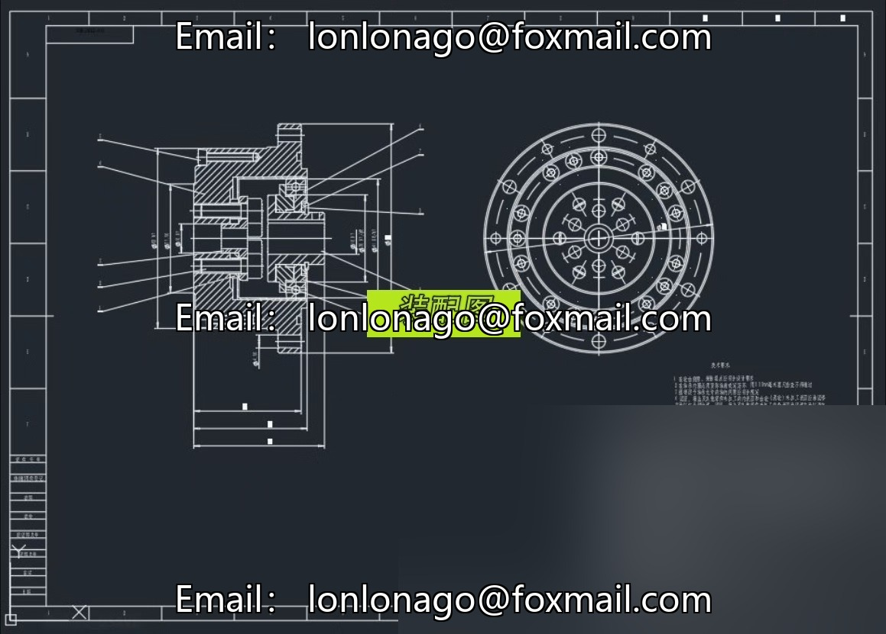
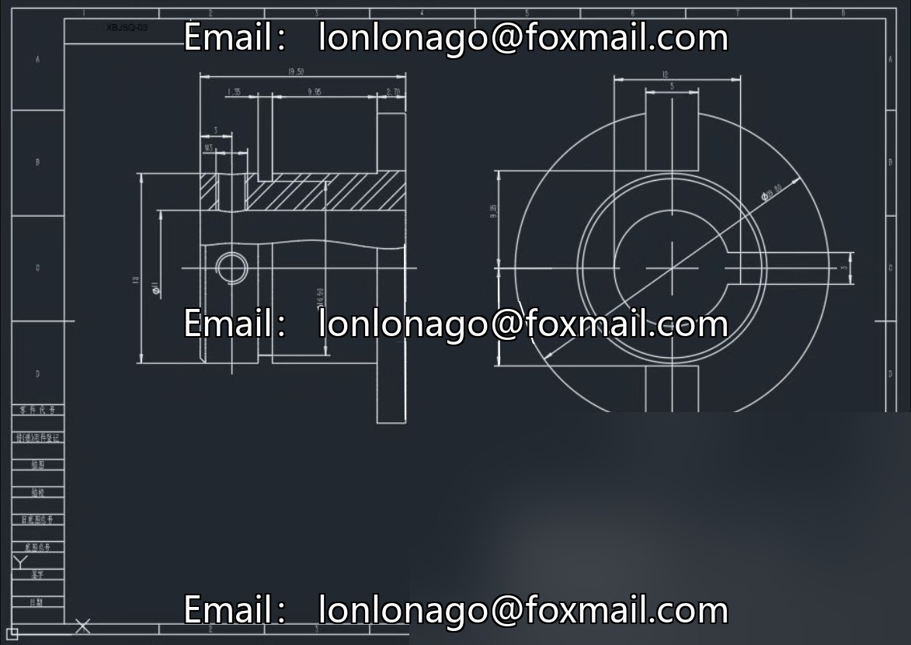

# Harmonic reducer design diagram; harmonic reducer diagram; harmonic reducer design CAD diagram

## Body

Harmonic reducer design diagram harmonic reducer diagram harmonic reducer design CAD diagram
166 Harmonic transmission reducer mainly consists of four basic components: wave generator, flexible gear, flexible bearing, and rigid gear. A harmonic transmission reducer is a gear transmission system that relies on the wave generator to assemble flexible bearings to cause controlled elastic deformation of the flexible gear, and then meshes with the rigid gear to transmit motion and force.

The design consists of harmonic reducer design and CAD figures; the images show assembly drawings, component codes, tools and drawing types.

<!-- AI_ENRICHED -->

## Images

## Payment

Here is a pay link on Stripe ( https://buy.stripe.com/3cs8yP7sY87d0vu9AB ). Please contact me lonlonago@foxmail.com after funding $89, and I will send you a complete data files , thank you!

